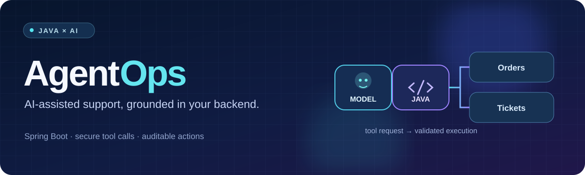
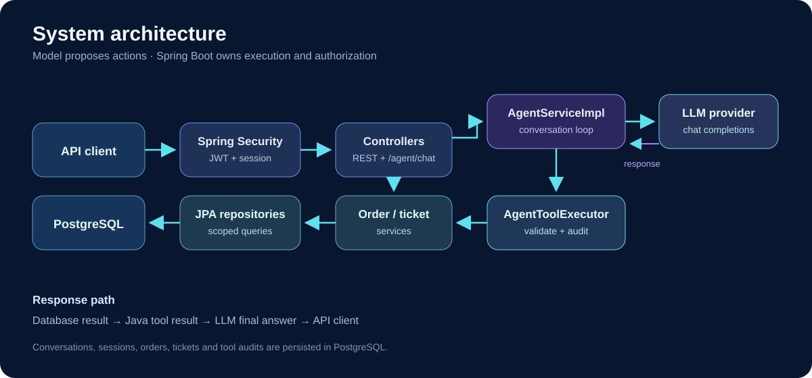
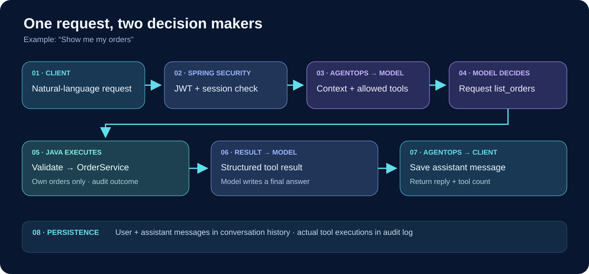
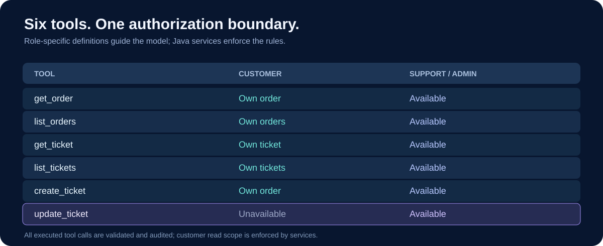
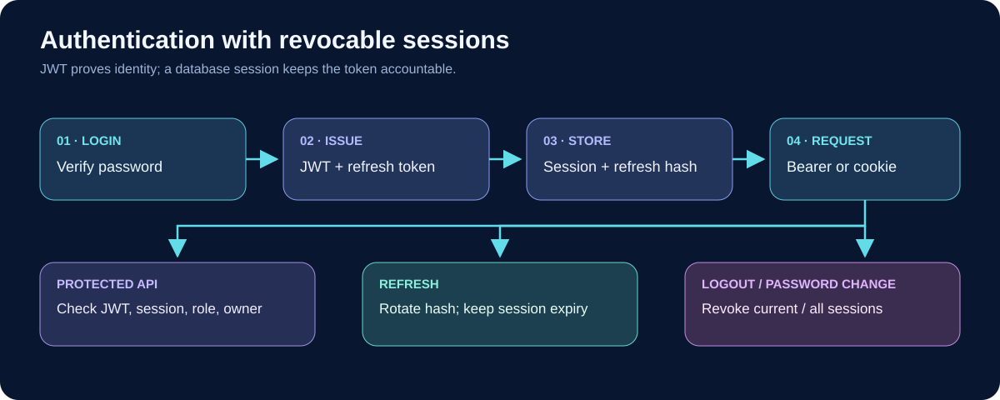
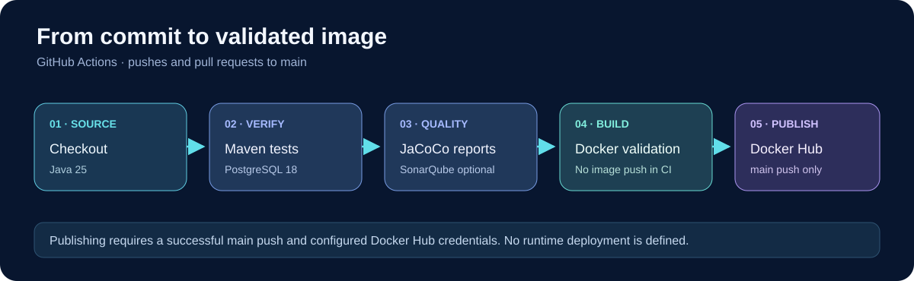

<div align="center">



<h1>AgentOps</h1>

<p><strong>A support agent that can ask for data. A Spring Boot backend that decides what it may do.</strong></p>

<p>An API-first portfolio project for order and ticket support, with authenticated AI tool calling, ownership-aware services, and auditable actions.</p>

<p>
  
  
  
  
  
</p>

<p><a href="#system-architecture">Architecture</a> · <a href="#how-the-agent-works">Agent workflow</a> · <a href="#getting-started">Run locally</a> · <a href="#api-overview">API</a></p>

</div>

## What is AgentOps?

AgentOps exposes REST APIs for users, orders, and support tickets. It also offers a natural-language endpoint: a user can ask **“Show me my orders”**, and the agent can request the `list_orders` tool. Java executes that request through the same order service used by the REST API, then returns the authorized result to the model for a readable reply.

The model selects a *proposed* tool call; it does not query PostgreSQL or change records itself. Spring Security, tool validation, and the domain services remain responsible for access and business rules.

### At a glance

| Capability | What the repository implements |
| --- | --- |
| AI support | Multi-round tool calling with six bounded order and ticket tools; provider timeout, output, and tool-call limits. |
| Business API | Paginated order and ticket reads, ticket creation and staff updates, plus registration and profile endpoints. |
| Security | HS256 access JWTs tied to persisted sessions; rotating refresh tokens; customer ownership and staff role checks. |
| Traceability | Stored user/assistant conversation messages and persisted tool execution outcomes. |
| Delivery | PostgreSQL-backed integration tests, JaCoCo reports, optional SonarQube analysis, and validated Docker builds in GitHub Actions. |

## System architecture



The `/agent/chat` controller delegates to `AgentServiceImpl`. `DeepSeekClient` sends conversation messages and tool definitions to an OpenAI-compatible chat completions endpoint. `AgentToolExecutor` checks each returned call and invokes `OrderService` or `TicketService`. Those services enforce ownership and staff permissions before accessing PostgreSQL. Direct REST endpoints use those same services.

The provider URL, model, and key are configurable through `DEEPSEEK_BASE_URL`, `DEEPSEEK_MODEL`, and `DEEPSEEK_API_KEY`. The default URL targets DeepSeek. An OpenRouter OpenAI-compatible endpoint can be configured with those settings; compatibility should be checked for the chosen model and endpoint. OpenRouter is a model gateway in this flow; AgentOps runs the business tools.

## How the agent works



1. The client sends `{"message":"Show me my orders"}` to `POST /agent/chat` with a valid access token.
2. Spring Security validates the JWT and its persisted session. The conversation store records the user message and loads recent messages owned by that user.
3. The backend sends context and the tools allowed for that role to the model.
4. The model may request `list_orders`. This is a request for Java to act, not a database query by the model.
5. `AgentToolExecutor` validates the name and arguments; `OrderService` applies ownership rules and reads the database. The execution outcome is audited.
6. The structured tool result goes back to the model, which writes the final response. AgentOps stores the assistant message and returns it to the client.

The orchestration loop has configurable limits for tool rounds and total calls. It caches successful, identical ticket writes within one chat turn to avoid repeating that same call in the turn; this is **not** a general idempotency guarantee. Only user and assistant messages are stored as conversation history; tool protocol messages are used during the active turn.

## Agent tools and permissions



| Tool | Purpose | CUSTOMER | SUPPORT / ADMIN |
| --- | --- | :---: | :---: |
| `get_order` | Read one visible order | Own | Available |
| `list_orders` | Page through visible orders | Own | Available |
| `get_ticket` | Read one visible ticket | Own | Available |
| `list_tickets` | Filter and page visible tickets | Own | Available |
| `create_ticket` | Open a ticket for an authorized order | Own order | Available |
| `update_ticket` | Change status, priority, or assignment | — | Available |

The customer tool list excludes `update_ticket`; the service layer also checks authorization if a call is attempted. Ticket writes are instructed to happen only after an explicit user request. The executor checks every tool's argument schema and applies Bean Validation to request DTOs where used. Tool executions are recorded with success, denied, or failure status.

## Authentication and security



- Registration creates a `CUSTOMER`; login creates a database-backed session. Passwords are encoded with PBKDF2.
- The API returns a signed HS256 access JWT and an opaque refresh token, and writes both as HttpOnly, SameSite Strict cookies. Clients can instead use the access token in an `Authorization: Bearer` header.
- Each authenticated request validates JWT issuer, expiry, claims, and its live session/role in PostgreSQL. Logout revokes the current session; a password change revokes the user's sessions.
- Refresh tokens are stored as hashes, rotated on refresh, and bounded by the original session expiry. Cookie-authenticated state-changing requests require a CSRF token; Bearer-only requests can use the API without cookies.
- Customer reads are scoped to their own orders, tickets, and conversations. Staff roles can access broader order/ticket operations. Validation errors and API failures use structured Problem Details responses.

This is a first-party JWT API using Spring Security's resource-server components; it does not run an OAuth authorization server.

## Tech stack

| Layer | Technologies |
| --- | --- |
| Backend | Java 25, Spring Boot 4.1.1, Spring Web MVC, Spring Data JPA, Bean Validation, Maven Wrapper |
| AI | Java `HttpClient`, configurable OpenAI-compatible chat completions API, function/tool calling |
| Identity | Spring Security, HS256 JWT, PBKDF2, persisted refresh sessions, CSRF protection for cookie requests |
| Data | PostgreSQL 18, JPA entities and repositories |
| Quality | JUnit/Spring Boot tests, JaCoCo, optional SonarQube, springdoc OpenAPI |
| Delivery | Docker multi-stage build, Docker Compose, GitHub Actions, Docker Hub publishing when configured |

## Getting started

### Option A · Docker Compose

Install Docker Desktop, copy the environment template, and replace the placeholder database password and JWT secret. A Java installation is not needed on the host for this path.

```powershell
Copy-Item .env.example .env
# Edit .env: set DB_PASSWORD and JWT_SECRET; add DEEPSEEK_API_KEY for chat.
docker compose up --build -d
curl.exe http://localhost:8080/health
```

Generate a Base64 secret from at least 32 random bytes, for example in PowerShell:

```powershell
$bytes = New-Object byte[] 32
[System.Security.Cryptography.RandomNumberGenerator]::Fill($bytes)
[Convert]::ToBase64String($bytes)
```

Place the printed value in `JWT_SECRET` in `.env`. Compose starts PostgreSQL and the backend, publishes the API on `localhost:8080` and PostgreSQL on `localhost:5433` by default, and waits for the database health check. `GET /health` returns `{"status":"UP"}` as a liveness response; it does not test the database or AI provider.

### Option B · local Java and PostgreSQL

Install **JDK 25** and PostgreSQL. Create a database named `agentops`, then copy `.env.example` to `.env` and set `DB_PASSWORD` and `JWT_SECRET`. The template sets `DB_DDL_AUTO=update` for local development; the application default is `none` if unset. Run from the repository root:

```powershell
.\mvnw.cmd spring-boot:run
```

On macOS/Linux, use `cp .env.example .env` and `./mvnw spring-boot:run`. The default local connection is `localhost:5432/agentops` with user `postgres`. Environment variables can override values in the root `.env` file. Leave `DEEPSEEK_API_KEY` empty to explore non-AI endpoints; chat returns HTTP 503 until a provider key is configured. API docs are at [`/swagger-ui.html`](http://localhost:8080/swagger-ui.html) while the server is running.

> **Database setup:** `update` is convenient for local exploration. The repository does not include versioned database migrations; plan a migration strategy before using a managed deployment.

## API overview

| Area | Endpoints | Access |
| --- | --- | --- |
| Health | `GET /health` | Public liveness |
| Auth | `GET /api/auth/csrf`, `POST /api/auth/register`, `POST /api/auth/login`, `POST /api/auth/refresh` | Public |
| Account | `GET /api/auth/me`, `PATCH /api/auth/me`, `POST /api/auth/logout` | Authenticated |
| Orders | `POST /orders`, `GET /orders`, `GET /orders/{orderId}` | Authenticated; scoped by role/owner |
| Tickets | `POST /tickets`, `GET /tickets`, `GET /tickets/{ticketId}`, `PATCH /tickets/{ticketId}` | Authenticated; staff only for update |
| Agent | `POST /agent/chat`, `GET /agent/conversations`, `GET /agent/conversations/{conversationId}` | Authenticated; own conversations |

Example with a Bearer token from the register or login response:

```http
POST /agent/chat HTTP/1.1
Authorization: Bearer <access-token>
Content-Type: application/json

{"message":"Show me my orders"}
```

```json
{
  "conversationId": 12,
  "reply": {
    "id": 34,
    "conversationId": 12,
    "role": "ASSISTANT",
    "content": "You have one visible order: #7.",
    "createdAt": "2026-10-15T12:00:00Z"
  },
  "toolCalls": 1
}
```

The response above is **illustrative**; IDs, wording, and tool count depend on stored data and the model response. Pass `conversationId` in a later chat request to continue an owned conversation. For cookie-based clients, obtain a CSRF token with `GET /api/auth/csrf` and send it on state-changing requests.

## Testing and CI/CD



Integration tests need PostgreSQL. With the local database and `.env` configured as above, run:

```powershell
.\mvnw.cmd clean verify
```

`verify` runs tests, packages the application, and writes JaCoCo reports to `target/site/jacoco/`. The agent tests use a local HTTP stub for the model provider. GitHub Actions runs against a PostgreSQL 18 service on pushes and pull requests to `main`, uploads test and coverage artifacts, and validates a Docker image build. SonarQube analysis runs on non-PR `main` executions when `SONAR_HOST_URL` is configured, and waits for its quality gate. A successful push to `main` publishes `latest` and commit SHA tags to Docker Hub when the required Docker Hub credentials are configured. The workflow does not deploy the image to a running environment.

## Project layout

```text
src/main/java/com/AgentOps/
├── agent/          # Provider client, tool executor, conversations, audit
├── controllers/    # Auth, order, ticket, agent, and health endpoints
├── services/       # Business interfaces and implementations
├── security/       # JWT, cookies, session validation, request security
├── entities/       # Persisted domain and session models
├── repositories/   # Spring Data access
├── dto/            # Request and response contracts
└── exceptions/     # API errors and validation responses
src/test/java/com/AgentOps/  # Unit and integration tests
docs/assets/readme/          # Original README diagrams
Dockerfile · compose.yaml · .github/workflows/ci-cd.yml
```

## Engineering decisions

- **Tools reuse business services.** Agent requests pass through the same authorization and validation rules as REST requests.
- **Sessions make access-token revocation meaningful.** JWT signature validation is paired with a database session check; refresh secrets are hashed and rotated.
- **Provider calls stay outside a long database transaction.** Conversation work and tool operations use their own persistence boundaries while the network request runs.
- **Agent scope is bounded.** The model receives role-specific tool definitions, and the server enforces schema, call count, result size, and service permissions.
- **History and audits serve different purposes.** Conversation history stores user/assistant messages; the tool audit records actual execution outcomes.

## Roadmap

Potential next steps: versioned schema migrations; deployment and operational monitoring; provider compatibility tests for selected OpenRouter models; stronger cross-request write idempotency; and a purpose-built approval workflow. These are plans, not current capabilities.

---

Built to demonstrate how a Java backend can give an AI assistant useful tools while keeping business decisions in tested services.
