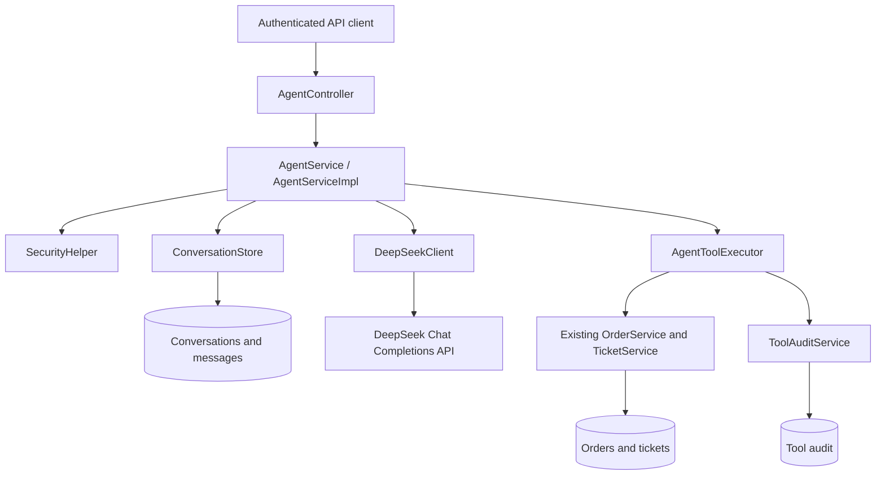

# AI Agent and Conversations — Implementation Record

This document describes the AI agent feature implemented in AgentOps. It covers
the actual code, API contracts, database changes, configuration, authorization,
tool execution, and verification. It does not describe planned features as completed.

## 1. Delivered functionality

The application now supports:

- Sending a message to DeepSeek and returning a synchronous AI response.
- Starting a conversation or continuing an existing conversation.
- Persisting user messages and completed assistant replies in PostgreSQL.
- Listing the authenticated user's conversations.
- Reading an owned conversation with paginated messages.
- Executing allowlisted order and ticket tools through existing business services.
- Recording successful, failed, and denied tool executions in `tool_audit`.

The implementation uses the existing Spring Boot stack, Java's `HttpClient`, and
Jackson. No additional AI SDK or Maven dependency was added.

## 2. Architecture and responsibilities



| Component | Responsibility |
| --- | --- |
| `AgentController` | Expose the three REST endpoints, validate input, and declare bearer authentication in OpenAPI. |
| `AgentService` | Define chat, conversation listing, and conversation detail operations. |
| `AgentServiceImpl` | Coordinate authentication, history, provider requests, tool execution, budgets, and final reply persistence. |
| `DeepSeekProperties` | Bind and validate environment-backed provider settings and execution limits. |
| `DeepSeekClient` | Send HTTP requests, parse assistant/tool responses, and translate provider failures into safe API exceptions. |
| `ConversationStore` | Own short database transactions for conversation claims, history, replies, and claim release. |
| `AgentToolExecutor` | Define the tool catalog, validate model arguments, call business services, and report tool outcomes. |
| `ToolAuditService` | Persist each actual tool execution's actor, name, argument summary, and status. |
| `AiProviderException` | Represent client-safe provider failures using the existing `ApiException` and `ProblemDetail` handling. |

Repository methods use Spring Data derived queries and `@Query`. No JPA
Specification classes or custom repository implementation classes were introduced.

## 3. REST API contracts

Every endpoint requires `Authorization: Bearer <accessToken>`. The existing JWT
security chain validates the token and authentication session.

### POST `/agent/chat`

Start a conversation:

```json
{
  "message": "Where is my order 123?"
}
```

Continue an existing conversation:

```json
{
  "conversationId": 42,
  "message": "Create a delivery support ticket for that order."
}
```

Validation:

- `message` is required, nonblank, and limited to 4000 characters.
- `conversationId` is optional; if supplied, it must be positive and owned by the caller.
- The server determines the user ID and message role. Clients cannot set the
  system prompt, provider configuration, or conversation owner.

Success returns HTTP 200 with an `AgentChatResponse`. Example values below are illustrative:

```json
{
  "conversationId": 42,
  "reply": {
    "id": 88,
    "conversationId": 42,
    "role": "ASSISTANT",
    "content": "Your order is currently pending.",
    "createdAt": "2026-10-13T12:00:00Z"
  },
  "toolCalls": 1
}
```

`toolCalls` counts model-requested calls processed during the turn. A repeated
identical successful write can reuse an earlier result and still count as a call.
The number therefore does not necessarily equal the number of new audit rows.

### GET `/agent/conversations`

Optional query parameters:

| Parameter | Default | Validation |
| --- | --- | --- |
| `page` | `0` | Non-negative integer. |
| `size` | `20` | Between 1 and 100. |

Returns `ConversationPageResponse` with `content`, `page`, `size`, `totalElements`,
and `totalPages`. Each conversation contains `id`, `userId`, and `createdAt`.
Results are ordered by conversation ID descending.

### GET `/agent/conversations/{conversationId}`

The ID must be positive. Pagination uses `page=0` and `size=50` by default,
with the same page/size validation as above.

Returns `ConversationDetailResponse` containing:

- `conversation`: conversation metadata.
- `messages`: persisted `MessageResponse` objects, ordered by message ID ascending.
- `page`, `size`, `totalElements`, `totalPages`: message pagination metadata.

Each message contains `id`, `conversationId`, `role`, `content`, and `createdAt`.
Requests for missing or inaccessible conversations return the same 404 response.
ADMIN and SUPPORT accounts do not gain access to another user's conversations.

## 4. Chat execution flow

1. Resolve the authenticated user ID through `SecurityHelper`.
2. Check that a DeepSeek API key is configured. If not, return 503 before creating
   a conversation or saving a new message.
3. Create an owned conversation or lock and claim an existing owned conversation.
4. Save the new user message with role `USER`.
5. Load recent user/assistant history and prepend the server-owned system instructions.
6. Send a non-streaming request to DeepSeek.
7. If DeepSeek requests tools, validate and execute them, record their outcomes,
   append the assistant tool calls and corresponding tool results to the in-memory
   provider transcript, and request another response.
8. When DeepSeek returns a final answer, save it with role `ASSISTANT` and return it.
9. Release the conversation's processing claim in `finally`, including on failures.

The server instructions tell the model to use tools for factual backend data,
avoid inventing IDs or successful changes, request missing details, and only
create/update tickets when the user explicitly requests that action. These are
model instructions; backend authorization is enforced separately by code.

Intermediate assistant/tool protocol messages are not persisted as conversation
messages. Their execution outcomes are persisted in the audit table. Provider
reasoning content is not stored or exposed; requests disable thinking mode.

## 5. Available backend tools

| Tool | Required arguments | Optional arguments | Existing service operation |
| --- | --- | --- | --- |
| `get_order` | `orderId` | None. | `OrderService.getOrder` |
| `list_orders` | None. | `page`, `size` | `OrderService.listOrders` |
| `get_ticket` | `ticketId` | None. | `TicketService.getTicket` |
| `list_tickets` | None. | `status`, `priority`, `category`, `orderId`, `customerId`, `assignedToId`, `unassigned`, `page`, `size` | `TicketService.listTickets` |
| `create_ticket` | `orderId`, `category` | None. | `TicketService.createTicket` |
| `update_ticket` | `ticketId` | `status`, `priority`, `assignedToId`, `unassign` | `TicketService.updateTicket` |

For `update_ticket`, the existing request validators require at least one update
and reject simultaneous assignment and `unassign=true`.

### Authorization

- Customers can query their own orders and tickets and create tickets for their
  own orders.
- SUPPORT and ADMIN can query customer records and create tickets on behalf of
  customers according to the existing services' rules.
- Only SUPPORT and ADMIN can update tickets. The update tool is also excluded
  from the tool definitions supplied for a customer.
- If the model nevertheless requests a forbidden operation, the underlying
  service still rejects it. Hiding a tool is not the authorization boundary.
- The model cannot supply an alternate authenticated user or role.

### Argument validation

Before dispatch, the executor checks:

- Tool name against a fixed allowlist.
- Arguments are a JSON object.
- Required properties are present.
- No unknown properties are supplied.
- IDs are integral JSON numbers in the positive Java `long` range. String IDs,
  fractions, null values, and overflowing numbers are rejected.
- Enum values match the backend enums exactly.
- Boolean properties contain JSON booleans.
- Tool page numbers are 0–10000 and page sizes are 1–20.
- Existing Jakarta DTO validators pass, including cross-field assignment checks.

The agent has no tool for SQL, arbitrary network requests, code execution, order
changes, user management, payments, or approvals.

### Tool results and auditing

Successful results are returned to DeepSeek as JSON with a `data` property.
Failures use an `error` object with a safe status and message. API exceptions
with status 401, 403, or 404 are classified as `DENIED`; other API failures are
classified as `FAILURE`. Unexpected runtime failures produce a generic tool error.

Each actual execution records:

| Audit field | Source |
| --- | --- |
| `user` | Authenticated caller. |
| `toolName` | Requested tool name. |
| `argumentsSummary` | Validated arguments, or a generic rejection summary. |
| `resultStatus` | `SUCCESS`, `FAILURE`, or `DENIED`. |
| `createdAt` | Existing entity-generated timestamp. |

Rejected raw arguments are not copied into audit summaries. Existing `tool_audit`
storage is reused; this feature does not add an audit-list endpoint.

## 6. DeepSeek integration and configuration

`DeepSeekClient` calls `<DEEPSEEK_BASE_URL>/chat/completions` using Java's HTTP client.
Requests include bearer API authentication, the configured model, conversation
messages, function schemas when enabled, `stream=false`, `thinking.type=disabled`,
and the configured output token limit.

The final budget-limited provider request omits tool definitions and sets
`tool_choice=none`. No automatic application-level retries are performed.
HTTP redirects are not followed.

| Environment variable | Default | Bounds / purpose |
| --- | --- | --- |
| `DEEPSEEK_API_KEY` | Empty. | Required for live chat; other endpoints can run without it. |
| `DEEPSEEK_BASE_URL` | `https://api.deepseek.com` | HTTP(S) URL with a host and no credentials, query, or fragment. |
| `DEEPSEEK_MODEL` | `deepseek-flash` | Nonblank, configurable model identifier. |
| `DEEPSEEK_TIMEOUT_SECONDS` | `30` | 5–120 per provider request. |
| `DEEPSEEK_MAX_OUTPUT_TOKENS` | `2048` | 256–8192. |
| `AGENT_MAX_TOOL_ROUNDS` | `4` | 1–8 tool rounds. |
| `AGENT_MAX_TOOL_CALLS` | `8` | 1–16 total model-requested calls per turn. |
| `AGENT_CONTEXT_MESSAGES` | `40` | 2–100 recent messages. |

The HTTP client also uses a 10-second connection timeout. Conversation context
is capped at 64000 characters, tool results at 20000 characters, and final
assistant content at 20000 characters. Oversized or malformed provider replies,
duplicate tool-call identifiers, and truncated final responses are rejected.

Add the key to your ignored `.env` file:

```dotenv
DEEPSEEK_API_KEY=replace-with-your-provider-key
```

`.env.example` documents the settings; `application.yml` binds them under
`agent.deepseek`; `compose.yaml` passes them to the backend container.
Conversation text and authorized tool results are sent to the provider.

Protocol references:

- [DeepSeek Chat Completions API](https://api-docs.deepseek.com/api/create-chat-completion/)
- [DeepSeek tool calls](https://api-docs.deepseek.com/guides/tool_calls/)

## 7. Persistence, concurrency, and failure semantics

### Database changes

| Entity/table | Change |
| --- | --- |
| `Conversation` / `conversations` | Add nullable `processing_token` (length 36) and `processing_started_at` fields. Add an index on `user_id`. |
| `Message` / `messages` | Add an index on `conversation_id`. Reuse existing role, content, and timestamp fields. |
| `ToolAudit` / `tool_audit` | Reuse the existing entity and table through a new repository/service. No new columns. |

Local `DB_DDL_AUTO=update` applies the schema changes. Deployments using `none`
or `validate` need the corresponding schema update before startup. No Flyway or
Liquibase migration was added.

### Conversation claims

An existing conversation is selected with `PESSIMISTIC_WRITE`, scoped to its
owner. A UUID processing token and start time identify the active turn. Another
chat turn for that conversation receives 409 while the claim is active.

The stale-claim interval is:

```text
timeoutSeconds × (maxToolRounds + 1) + 60 seconds
```

With default settings, the interval is 210 seconds. An expired claim can be
replaced when a new turn starts. Processing and final reply persistence check
the token so a superseded turn cannot complete the newer turn. Cleanup only
clears a claim when its token still matches.

### Transaction boundaries

`AgentServiceImpl.chat` is intentionally not transactional. Conversation storage,
business service actions, and audit persistence use their own short transactions;
provider requests do not hold a production database transaction open.

A user message is saved before the first provider request. If the provider fails,
that message remains, but no successful assistant reply is fabricated.
Successful tool writes and their audits remain committed if a later provider
request fails. Conversation history and existing tickets should be checked before
retrying a write after such a failure.

Identical successful write calls within the same turn are deduplicated using the
tool name and canonically sorted arguments. This protection does not span HTTP
requests or conversation turns. Separate requests can create separate tickets.

## 8. Error handling

Existing `GlobalExceptionHandler` returns `ProblemDetail` with
`application/problem+json`; this feature does not introduce `ResponseEntity` wrappers.

| Status | Situation |
| --- | --- |
| 400 | Invalid message, conversation ID, or pagination. |
| 401 | Missing, invalid, expired, or revoked bearer authentication. |
| 404 | Missing or inaccessible conversation. |
| 409 | An active turn is already generating a reply, or the turn was superseded. |
| 502 | Provider failure, invalid/truncated response, repeated tool-call ID, or exhausted execution budget. |
| 503 | Missing provider key, upstream rate limit, or interrupted provider request. |
| 504 | Provider request timeout. |

Tool-level errors are ordinarily sent back to DeepSeek inside the tool transcript
so it can explain the limitation. They do not automatically become the HTTP status
of a completed chat response. Provider error bodies and API credentials are not
returned to clients.

## 9. Files added and modified

Paths below are relative to the repository root.

### Added for the AI feature

```text
src/main/java/com/AgentOps/
  agent/
    AgentToolExecutor.java
    ConversationStore.java
    DeepSeekClient.java
    DeepSeekProperties.java
    ToolAuditService.java
  controllers/AgentController.java
  dto/request/AgentChatRequest.java
  dto/response/
    AgentChatResponse.java
    ConversationDetailResponse.java
    ConversationPageResponse.java
  exceptions/AiProviderException.java
  repositories/
    ConversationRepository.java
    MessageRepository.java
    ToolAuditRepository.java
  services/AgentService.java
  services/servicesImp/AgentServiceImpl.java
src/test/java/com/AgentOps/
  AgentIntegrationTests.java
  AgentToolExecutorTests.java
```

### Modified for the AI feature

| File | Change |
| --- | --- |
| `src/main/java/com/AgentOps/entities/Conversation.java` | Processing claim fields and owner lookup index. |
| `src/main/java/com/AgentOps/entities/Message.java` | Conversation lookup index. |
| `src/main/resources/application.yml` | Environment-backed DeepSeek and execution settings. |
| `.env.example` | Example provider/execution variables. |
| `compose.yaml` | Forward those variables to the backend container. |
| `README.md` | Configuration, endpoint, tool, persistence, and testing documentation. |

`docs/AI_AGENT_IMPLEMENTATION.md` is the standalone implementation record added
after the feature was completed.

## 10. Verification performed

### Unit tests: `AgentToolExecutorTests` — 8 tests

- Unknown tools are denied without calling business services.
- Malformed JSON, unknown fields, wrong types, invalid IDs, and overflow are rejected.
- DTO cross-field validation rejects conflicting assignment requests.
- Ownership failures are returned as denied tool outcomes and audited.
- Successful tools invoke existing services and create success audit records.
- Invalid enums and oversized tool pages are rejected.
- Customer tool catalogs hide the staff update operation.
- Missing provider credentials return 503 without a network request.

### Integration tests: `AgentIntegrationTests` — 12 tests

These use JWT security, PostgreSQL, and the real HTTP adapter against a local
scripted DeepSeek-compatible server. They cover:

- New and continued conversations, persisted history, and message pagination.
- Conversation privacy, including against other ADMIN accounts.
- Correct tool-call/result protocol and success auditing.
- Denied cross-customer order access and forbidden customer ticket updates.
- Duplicate-write protection when the model repeats a ticket creation call.
- Authorized staff ticket updates.
- Busy-conversation rejection and expired-claim recovery.
- Sanitized provider failures and processing-token cleanup.
- Malformed/truncated responses and upstream rate limits.
- Tool-round limits and final-request tool disabling.
- Request validation and unauthenticated endpoint rejection.
- Persistence of a successful ticket write and audit after a subsequent provider
  failure, using committed transactions and explicit cleanup.

The full suite passed **118 tests**. After adding the committed-transaction test,
all **12 agent integration tests** passed in a targeted verification run. Combined
current reports cover **119 passing tests**, with zero failures or errors.
Maven packaging, Docker Compose configuration validation, and `git diff --check`
also succeeded.

No live DeepSeek request or paid API call was made. Live account credentials,
model availability, and actual model answer quality were not verified by these tests.

To rerun with a configured disposable PostgreSQL database:

```powershell
.\mvnw.cmd -B -ntp verify
```

To run only the agent tests against that database:

```powershell
.\mvnw.cmd -B -ntp "-Dtest=AgentToolExecutorTests,AgentIntegrationTests" test
```

Use a disposable database with `DB_DDL_AUTO=create-drop` for verification; these
settings create and drop the application schema. The local provider stub supplies
its own test URL and dummy key, so real DeepSeek credentials are not needed.

## 11. Current boundaries

- Chat is synchronous; streaming/SSE is not implemented.
- Only the six documented tools are available.
- No approval request/decision/execution workflow was added.
- No conversation deletion, renaming, title generation, search, or sharing was added.
- Intermediate tool transcripts and provider reasoning are not stored in message history.
- Tool audits are associated with users, not linked to conversations by a new foreign key.
- Duplicate-write prevention is limited to one chat turn; there is no cross-request
  idempotency key or exactly-once execution guarantee.
- A provider failure does not roll back an already committed backend action.
- Stale claims use the configured recovery interval; this is not a durable background
  job runner that automatically resumes requests after a process restart.
- Live use requires a configured DeepSeek API key.
